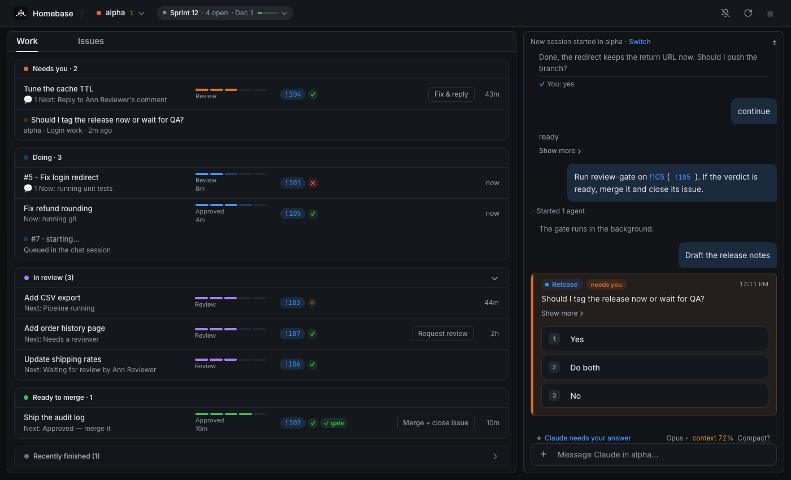
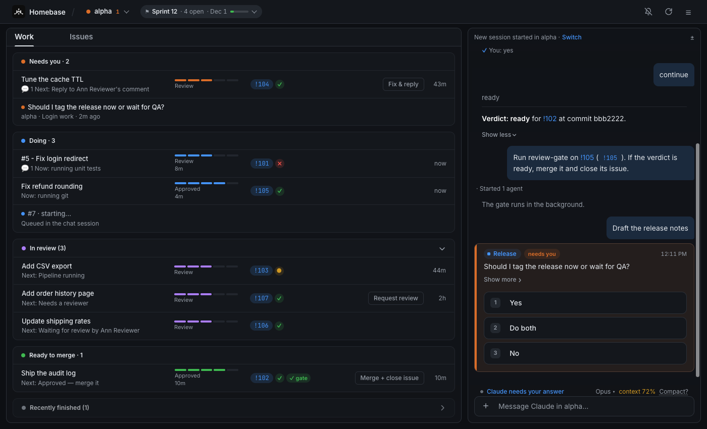
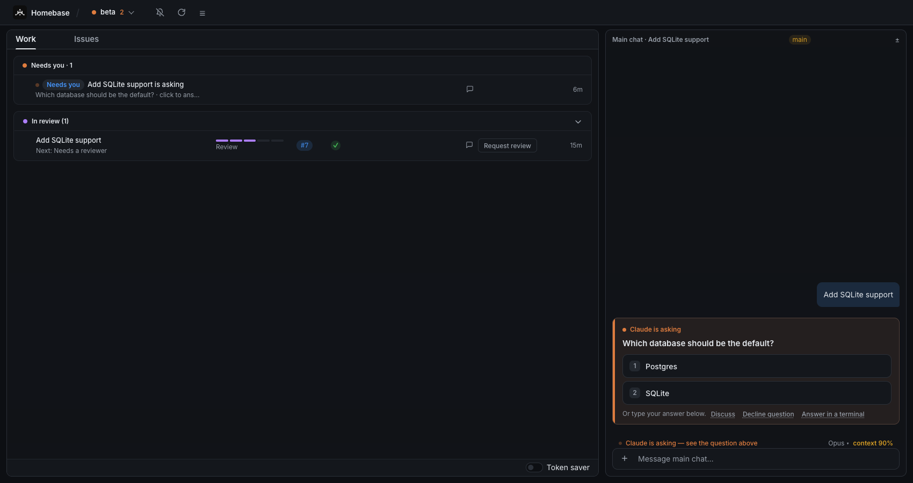
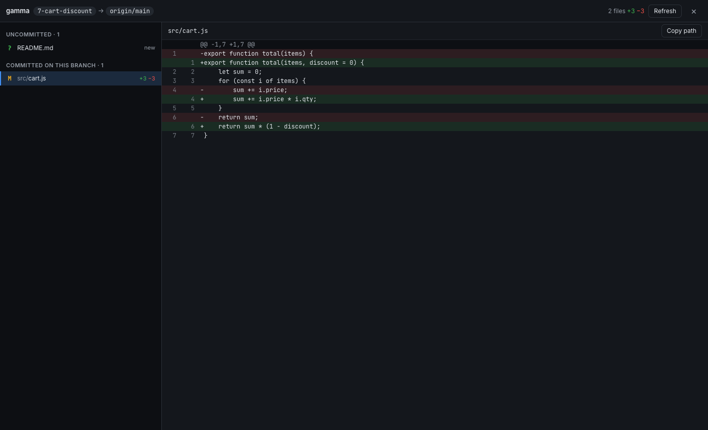
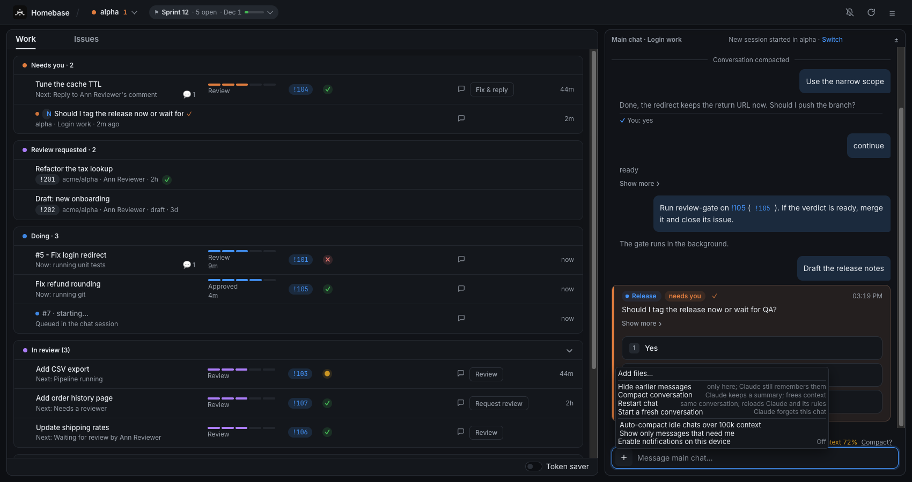
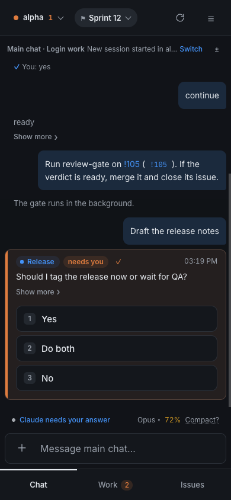
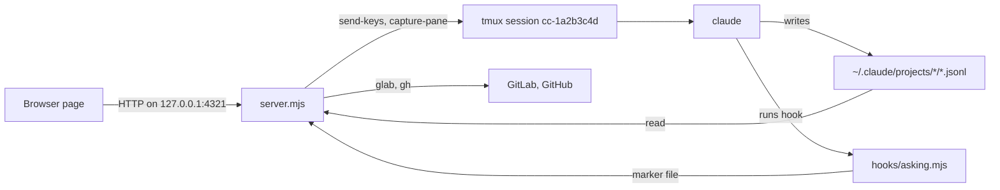

# Homebase

Homebase is a local web page for running several Claude Code sessions at once.
Each Claude runs in its own tmux session on your Mac; Homebase reads their transcripts and shows, per project, what needs you, what is being worked on and what is in review, next to a chat with the session you picked.
Tell one main chat what you want and it starts helpers, each a Claude of its own in its own worktree; you answer their questions with a click, review the diffs and merge, from your desk or your phone.
It is one Node process with no npm dependencies and no build step; the few browser libraries it uses are checked in under `public/vendor`.



All screenshots show invented fixture data; `node scripts/screenshots.mjs` retakes them.

## Try the demo

```sh
git clone https://github.com/lommerusk113/homebase.git && cd homebase
node server.mjs --demo    # or: npm run demo
```

It needs only Node.js 20 or newer and `git`: no tmux, no `claude` CLI, no sign-in.
The command prints a `http://localhost:<port>` address on a free port; open it in a browser.
You get the same invented projects as in the screenshots, with a "Demo" marker in the header.
Everything can be looked at, but nothing is sent: a message or an answer comes back as "Not sent" with the reason.
The demo runs in a temp folder with its own home directory, so it never reads your `~/.claude`, your tmux sessions or a Homebase you already run on port 4321.
Ctrl+C stops it and removes the temp folder.

## What you get

* **A board per project.** Pick the projects you follow; the Work tab sorts their items into "Needs you", "Review requested" (each row has a Review button that starts a chat reviewing the MR read-only), "Doing", "In review" and "Ready to merge" (an approved GitLab MR has a Merge button that asks first, then merges it at the commit shown, with no auto-merge; while something still stops the merge the row says what, with no Run gate or Review button), and the Issues tab shows the milestone's issues. A milestone picked in the header limits the board to its issues; a chat waiting on you, and a main chat's own row, is shown whatever the milestone. Merge requests and pull requests come from `glab` and `gh`. Inside a group rows keep their place, newest work first by when the row first appeared, and only move when their group changes; `docs/row-states.md` says which group each state goes in. A row with no MR or PR to act on (a helper that stopped or finished) has a Dismiss button, which puts it away on every device until that helper works again.
* **Helpers as rows.** A chat starts helpers with `homebase helper start`; each is its own Claude in its own tmux and worktree, and shows as a row under the chat that started it. Open chat steps into it and what you type goes straight to it; Stop closes it. See "Helper in its own chat" below.
* **A chat view.** The transcript of one session, with each reply collapsed to its `TLDR:` line; "Show more" opens the full reply.

  
* **Questions as buttons.** When Claude asks (AskUserQuestion) or waits on a permission prompt, the options show as buttons and the chat is listed under "Needs you". A short question at the end of a reply gets reply buttons too. A reply that says "needs you" when nothing does can be marked as handled with the ✓ beside its pill or on its "Needs you" row.

  
* **Subagent rows.** Each subagent a chat starts is a row on the Work tab with what it is doing now, the MR it belongs to and that MR's pipeline.
* **A diff viewer.** "Changes" lists the uncommitted and committed files of a chat's folder, or of a subagent's worktree, and shows each file's diff. It is read-only.

  
* **A composer with a menu.** Type a message, paste or drop images, or run a slash command. The + menu adds files, hides earlier messages, starts a fresh conversation (in the chat's own folder, even after it cd'd into a worktree), compacts, restarts the chat and switches notifications on.

  
* **Auto-compact.** A chat that has been idle for 2 minutes with more than 100k tokens of context, and no subagent running, gets `/compact` typed for it, at most once an hour. From 70k the chat offers "Compact?". It is on by default, the + menu switches it off, and it only happens while a Homebase page is open.
* **Token saver.** A switch under the board that tells the main chat to run fewer helpers and keep them on cheaper models. It turns itself on at 90% of the five-hour usage limit and stays off after you switch it off until usage drops back under 90%.
* **Remote access.** The same page on your phone through Tailscale, with every device paired by a one-time code, and Web Push when a chat needs you. See [Security](#security) and [Use from your phone](#use-from-your-phone-tailscale).

  

Words used below:

* **Hook**: a command Claude Code runs at fixed moments (before a tool, when a turn ends). Homebase adds five, all running `hooks/asking.mjs`.
* **Statusline**: the command Claude Code runs to fill the line under its input box. Homebase's also saves the numbers it is given, which is where the rate limits in the page header come from.
* **☰ dialog**: the menu behind the ☰ button in the page header: your projects, new project, open folder, pair a device.
* **Homebase dir**: `~/.claude/homebase`, where Homebase keeps its own files.
* **`TLDR:` line**: a one-line summary Claude puts in each reply, because the rules file asks for it.
* **Needs you**: a chat that waits on your answer, a permission or a decision. When its question names an open MR or PR first (`!1856`, `MR 1856`, its URL), that row moves to Needs you and stands for the question; otherwise the chat gets a row of its own, whatever milestone is picked.
* **Doing**: an MR's row is in Doing while a chat or helper works on it (also while only its background commands run, like a test run): one that reported the MR with `homebase status doing --mr !N "<what>"`, or one whose folder has the MR's branch checked out. The row then shows what it does and offers no Rebase or other MR button. Clicking a row's button also holds it in Doing ("Sent to Claude") until the MR's state changes. `homebase status needs-you --mr !N "<question>"` puts the row in Needs you while that chat isn't working, and `homebase status done` clears the report; a newer prompt to the chat ends it too.
* **MR, PR, pipeline, milestone, forge**: a merge request (GitLab) is a pull request (GitHub); a pipeline is its CI run; a milestone is a named set of issues; a forge is GitLab or GitHub.
* **Subagent**: a second Claude that a chat starts inside its own process (the Agent tool), for read-only lookups; its row opens its conversation read-only, as you can't message it. A **worktree** is the separate checkout of the repo it may work in. A **work item** is one row on the Work tab.
* **Helper in its own chat**: one started with `homebase helper start` (bin/homebase.mjs) runs as its own Claude in its own tmux, in a worktree under the project's main checkout (also when the chat that started it sits in a linked worktree). Its row sits under the chat that started it; Open chat steps into it, and what you type there goes straight to it (Back returns to that chat); Stop closes it, asking first while it works. The chat that started it keeps it across `/clear`. Homebase closes a helper by itself when its Claude exits, when the chat that started it is gone for 10 minutes and it isn't working, after 30 minutes idle, or after waiting on you for a day; its transcript, and its branch unless merged, are kept. A closed helper's chat stays readable but takes no messages.

## How it works

* One tmux session per Claude, named `cc-<id8>` (the first 8 characters of the session id). tmux keeps Claude running between messages, and `tmux attach -t cc-<id8>` reaches it from any terminal.
* The server reads the transcripts Claude Code writes under `~/.claude/projects`. It keeps no copy of them. The page asks the server for the current state every 1.5 seconds.
* A message you send is typed into the tmux session with `tmux send-keys` (several lines go in as one paste), then Enter. A chat with no tmux session gets one started with `claude --resume <id>`. A session that is still open in a terminal outside Homebase shows on the page, but a send is refused with "Quit it there (/exit), then send again", so Homebase does not start a second Claude on it.
* `hooks/asking.mjs` is a Claude Code hook. It writes a small marker file while a session waits on a question or a permission prompt, because Claude Code writes some questions to the transcript only once they are answered. The options are also read from the tmux pane, and a click selects one there.
* `homebase-rules.md`, then your `homebase-rules.local.md` when it exists, is appended to the system prompt of every Claude that Homebase starts or resumes (`--append-system-prompt-file`). It tells Claude how replies, helpers and questions fit Homebase.



## Why tmux, not the Agent SDK

Homebase does not run its own agent: it types into the interactive `claude` you already use, started through your login shell inside tmux.

What that buys:

* Chats use the sign-in, settings, hooks, plugins and `CLAUDE.md` files your terminal's Claude Code uses, and slash commands typed in a chat reach the same program.
* `tmux attach -t cc-<id8>` opens the very same chat in any terminal, and it keeps running when the Homebase server stops.
* Chats you start in a terminal show on the board too, because Homebase reads the transcripts Claude Code writes itself.

What it costs: Claude Code offers no interface for this, so Homebase reads its screen (`tmux capture-pane`) and its transcript files, and neither format is documented. A Claude Code update can break status, questions or sends.

How that is contained: `VERIFIED_CLAUDE` in `server/setup.mjs` names the newest Claude Code the parsing was checked with (2.1.331 now). When the installed one is newer, `node server.mjs --doctor` and the server's start-up output say so. The page header warns only when a transcript has no turn markers or a question is asked that the screen parser cannot read. `tests/fixtures/` holds screens captured from a real Claude Code, which the unit tests parse.

## The rules file changes how Claude replies

Every chat Homebase starts or resumes gets `homebase-rules.md` added to its system prompt, so Claude answers differently there than in a plain terminal chat.
Read the file before you start: it is short.

What it asks of Claude, and what the page does with it:

* A first line `**▸ <Topic>**`. The page shows it as the reply's header and as what the chat is working on.
* A last line `**TLDR:** …`. The page shows only that line until you open the reply; a reply without one is cut to its first sentence.
* Questions asked with the AskUserQuestion tool. The page shows the options as buttons, and a click selects one in the terminal.

It also holds advice on formatting, searching and images.
A chat started in a terminal without Homebase does not get the file, and its replies still show, only without a topic and folded to their first sentence.

To add your own rules, put them in `homebase-rules.local.md` next to it: that file is gitignored and appended after the tracked one, so it only needs your own parts (see Configuration).
Keep the three points above if you want the header, the fold and the buttons to work.

## What Homebase writes to Claude's settings file

Homebase changes `~/.claude/settings.json` in these cases only.

* `node server.mjs --setup` adds its hooks and statusline, and `--unsetup` removes them, each after showing the change and asking (see Setup and Uninstall).
* A `/model <alias>` sent from a chat, such as `/model opus`. Claude Code saves that pick as the default model for every chat, and a pick made in one Homebase chat is meant for that chat only. So Homebase waits up to 5 seconds for the `model` key to change and then puts the old value back (or removes the key). The other keys are kept, but the file is rewritten as 2-space JSON, and a `/model` you typed in a terminal in the same seconds is reverted too.

Before the first such rewrite after each server start, the file is copied to `settings.json.<timestamp>.bak` next to it, the same kind of backup setup makes.

## Requirements

* macOS. Linux is untested: the demo needs only Node, the keychain token for [New project](#new-project) is macOS only, and doctor prints a warning.
* Node.js 20 or newer, `tmux`, and the `claude` CLI on the PATH of your login shell (`$SHELL -lic`).
* Optional: `gh` and `glab`, signed in, for GitHub PRs and GitLab MRs.

## Setup

1. Get the code. There is nothing to install or build. If you did the demo you already have it; skip this step.

   ```sh
   git clone https://github.com/lommerusk113/homebase.git
   cd homebase
   ```
2. Check what is missing.

   ```sh
   npm run doctor           # the same as: node server.mjs --doctor
   ```

   It checks Node, tmux, claude and the five hooks (required), and `gh`, `glab` and the statusline (optional). It prints one line per check, starting with `ok`, `missing`, `optional` or `warning`, and changes nothing. Only a `missing` line has to be fixed.
3. Add the hooks and the statusline to Claude Code's settings.

   ```sh
   npm run setup            # the same as: node server.mjs --setup
   ```

   It shows the entries it will add to `~/.claude/settings.json` and asks y/N before it writes. It copies the file to `settings.json.<timestamp>.bak` first. Hooks and keys you already have stay as they are. If you already have a different statusline, it asks separately before replacing it. That file is Claude Code's user settings, so the hooks run in every Claude Code session on this Mac, not only the ones Homebase starts; see [What Homebase reads, changes and sends](#what-homebase-reads-changes-and-sends) and [Uninstall](#uninstall).
4. Start the server and open the page.

   ```sh
   npm start                # the same as: node server.mjs; http://localhost:4321 (set PORT to change)
   ```
5. Pick your projects in the ☰ dialog ("Projects on your board"). Homebase lists sessions whose transcript was written in the last 3 days, so the page is empty if you have not used Claude Code in that time.
6. Start your first chat: ☰ → "Open existing folder…", pick a repo, and type a message in the box at the bottom. The list holds the git repos directly under `~/Projects`; if your code is somewhere else, set `baseDir` (see [New project](#new-project)).
7. Optional: phone access, see [Use from your phone](#use-from-your-phone-tailscale).

What setup adds, with `<homebase-dir>` as the absolute path of this checkout:

```json
{
  "hooks": {
    "PreToolUse": [{ "matcher": "AskUserQuestion", "hooks": [{ "type": "command", "command": "node '<homebase-dir>/hooks/asking.mjs'" }] }],
    "PostToolUse": [{ "hooks": [{ "type": "command", "command": "node '<homebase-dir>/hooks/asking.mjs'", "async": true }] }],
    "Notification": [{ "matcher": "permission_prompt", "hooks": [{ "type": "command", "command": "node '<homebase-dir>/hooks/asking.mjs'" }] }],
    "UserPromptSubmit": [{ "hooks": [{ "type": "command", "command": "node '<homebase-dir>/hooks/asking.mjs'" }] }],
    "Stop": [{ "hooks": [{ "type": "command", "command": "node '<homebase-dir>/hooks/asking.mjs'" }] }]
  },
  "statusLine": { "type": "command", "command": "'<homebase-dir>/scripts/statusline.sh'" }
}
```

The hook never blocks or changes anything in Claude Code and prints nothing. Without it, only questions already in the transcript show.
The statusline script saves Claude Code's status JSON, which is where the rate limits in the header come from.
The path is in quotes so a checkout under a folder with a space works; entries an earlier setup wrote without quotes still count.
The entries hold the absolute path of the checkout. To move it, run `npm run unsetup` before the move and `npm run setup` after it; doctor warns about entries that point at another checkout.

## What Homebase reads, changes and sends

* **Reads**: the transcripts under `~/.claude/projects` and the list of running sessions under `~/.claude/sessions`, the screen of its tmux sessions, and git state (status, diffs, branches) in the folders of the sessions it shows. It keeps no copy of the transcripts.
* **Changes in Claude Code's settings**: setup adds the hooks and the statusline to `~/.claude/settings.json`, which applies to every Claude Code session on this Mac. The hook only writes and removes a marker file in the Homebase dir. Picking a model in a chat makes Claude Code save it as your default, so Homebase puts the `model` key in that file back to what it was.
* **Changes in your chats**: `homebase-rules.md` is appended to the system prompt of every chat Homebase starts or resumes; it asks for a topic line, a `TLDR:` line, short replies and a certain use of helpers and questions. A chat you start yourself in a terminal gets it only once Homebase resumes it. [Auto-compact](#what-you-get) is on by default.
* **Writes**: its own files in the Homebase dir (see [Configuration](#configuration)). "New project" creates a GitHub repo and clones it.
* **Sends**: Homebase has no telemetry and calls no server of its own. What leaves the Mac is what Claude Code sends, what `gh` and `glab` send when Homebase asks them for your MRs, PRs, pipelines and issues, and, only after you enable notifications on a device, an encrypted Web Push through that browser's push service with the project name and up to 300 characters of the question or last reply.

## Update

```sh
git pull
npm run doctor
```

A running server notices the new code: the page header offers "Reload server". Otherwise restart `npm start`.
Maintainers: `npm run ship [-- --no-browser]` on a clean `main` runs the unit, type and browser checks, pushes to origin and reloads the running server (honours `PORT`; `--dry-run` skips push and reload).
`npm run land <branch>` fast-forwards a clean `main` to a helper branch (refuses with "needs a rebase onto main" otherwise), runs ship, then removes the branch's worktree and branch, or stops it if it is a registered helper. Land and ship queue on one lock in `.git`; a failed ship leaves main at the new tip.
Run `npm run setup` again when doctor reports something missing. Your own `homebase-rules.local.md` and the Homebase dir are not touched by a pull.

## Uninstall

```sh
npm run unsetup          # the same as: node server.mjs --unsetup
```

It removes the hook entries and the statusline that point at this checkout from `~/.claude/settings.json`, and nothing else: your own hooks, a statusline of your own and entries of another checkout stay. Like setup it shows what it will remove, asks y/N and saves a `.bak` copy first.
Then stop the server, end the chats you no longer want (`tmux ls` lists them as `cc-…`, `tmux kill-session -t <name>` ends one), and delete the checkout and `~/.claude/homebase`. If you use phone access, also stop `tailscale serve`.

## Troubleshooting

* **Doctor says `missing`**: each line ends with what to run. `tmux`: `brew install tmux`. `claude`: it must be found by your login shell (`$SHELL -lic 'command -v claude'`). A hook: `npm run setup`.
* **Doctor warns about another checkout**: the settings hold Homebase entries with a different path, from a checkout you moved, deleted or have twice. Run `npm run unsetup` in that checkout if it still exists, else delete those entries from `~/.claude/settings.json` by hand.
* **"Port 4321 is already in use"**: another Homebase or another program has the port. Stop it, or start with `PORT=4400 npm start`.
* **The page is empty**: no session was written in the last 3 days, or no project is picked. Do steps 5 and 6 of [Setup](#setup), or raise `MAX_AGE_DAYS`.
* **"Open existing folder…" lists nothing**: it only looks directly under `~/Projects`; set `baseDir` (see [New project](#new-project)).
* **A question shows without buttons, or a chat never shows under "Needs you"**: the hooks are not firing. Run `npm run doctor`. A session that was already running when you ran setup may need a restart ("Restart chat" in the + menu). The hook command is plain `node`, so `node` must be on the PATH Claude Code runs hooks with; a version manager that only sets it in an interactive shell may leave it out. A failing hook shows nothing in Homebase.
* **No rate limits in the header**: the statusline is optional and not set, or you kept your own; `npm run setup` offers Homebase's.
* **"Claude for this chat is running in a terminal outside Homebase"**: quit it there with `/exit`, then send again.

## Configuration

Environment variables of the server:

* `PORT`: the local port (default 4321).
* `HOMEBASE_DIR`: where Homebase keeps its own files (default `~/.claude/homebase`). The hook and the statusline script are run by Claude Code, not by the server, so they follow it only if the variable is also set where Claude runs (for example in your shell profile).
* `MAX_AGE_DAYS`: how old a transcript may be and still be listed (default 3). A chat that still waits on your answer stays listed for up to 14 days.
* `HOMEBASE_CLAUDE_SETTINGS`: the settings file that doctor and setup read and write (default `~/.claude/settings.json`).

Optional settings live in `config.json` in the Homebase dir. Homebase never writes it. Its two keys are `newProject` (see [New project](#new-project)) and `remote` (see [Use from your phone](#use-from-your-phone-tailscale)).

`homebase-rules.md` in this checkout is the text every Homebase chat gets.
To add your own rules, put them in `homebase-rules.local.md` next to it. That file is gitignored and appended after the tracked one, so a chat gets both and yours win where they differ. Homebase joins them into `rules-combined.md` in the Homebase dir when a chat starts or resumes, so a new chat picks up a change without a server restart.
Edit the rules file to change how all Homebase chats behave; chats already running show a strip whose "Load new rules" has Claude re-read it (and `~/.claude/CLAUDE.md`) without a restart; "Restart chat" reloads Claude fully.

What Homebase stores, all in the Homebase dir:

* `items.json`: the MRs/PRs it has seen, so the Work view doesn't lose one when its link scrolls out of a transcript; deleting the file is safe.
* `uploads/`: images attached in the chat (paste, drop or the + menu). They are sent as `[Image: <path>]` lines, which Claude opens with its Read tool; the folder is never cleaned up, so delete old files when you like.
* `asking/<session>.json`: the hook's markers. The answer, the next tool (for a permission prompt), a new prompt or the end of the turn removes the marker; Homebase also ignores one the transcript has moved past, a permission prompt that was answered (Claude's input box is back on the chat's screen while the approved tool still runs), or one older than a day.
* `tracked.json`: the projects on your board.
* `handled.json`: the replies you marked as handled (the newest 500), as `<session>/<reply>` ids.
* `dismissed.json`: the work rows you dismissed (the newest 500), as helper id and time; a row comes back when its helper works again.
* `sent.json`: the row buttons you clicked in the last 30 minutes, so a clicked row stays in Doing across a restart.
* `vapid.json` and `subscriptions.json`: the Web Push keys and subscriptions; this computer's browser and paired devices may subscribe.
* `devices.json`: the paired devices (see [Use from your phone](#use-from-your-phone-tailscale)).

Push notifications: "Enable notifications on this device" in the chat's + menu makes the server send a Web Push when a chat starts asking or needs you, at most one per chat per 30s, and none while a Homebase page was focused in the last minute.
They arrive with the page closed. On an iPhone (iOS 16.4+), open Homebase over HTTPS, add it to the Home Screen, open it from there and enable it in the menu.

## New project

The ☰ dialog's "New project…" button asks for a name, creates a GitHub repo for your account, clones it, starts a Claude chat in tmux (`cc-new-<name>`) and adds the project to your board.
It runs `gh` as you are signed in (`gh auth login`); to use a separate token instead, put it in the macOS keychain (`security add-generic-password -s <service> -a "$USER" -w`, a fine-grained token that may create repositories) and name the item as `keychainService` below.
A keychain token is read when you press Create, kept in memory, handed only to `gh` as `GH_TOKEN` (with `GITHUB_TOKEN` removed), and scrubbed from any error shown.
Claude Code's workspace trust dialog for the new folder is answered "Yes" for you, but only when the dialog names exactly the folder Homebase just cloned; nothing else is ever auto-answered.
How other startup dialogs and slash-command panels are handled is in [`docs/internals.md`](docs/internals.md).
If creating the repo fails nothing else happens; if cloning or starting the chat fails, the error says what already exists.

To chat in a project that is already on disk, use "Open existing folder…" in the ☰ dialog (or "Open" on an already cloned repo under "From my GitHub").
It lists the git repos directly under `baseDir`, most recently used first, leaving out any that already have a running Claude or tmux session, and starts a Claude chat there the same way (`POST /api/projects/open` with `{ "dir": ... }`).
The server only starts it in an existing folder whose real path (symlinks and `..` resolved) is inside `baseDir`, or is the folder of a session it already shows; the trust dialog is answered for that folder too.

The defaults can be overridden in `~/.claude/homebase/config.json` (`HOMEBASE_DIR` moves it). The file is optional, lives outside the repo and Homebase never writes it:

```json
{ "newProject": { "owner": "my-github-login", "keychainService": "gh-personal", "sshHost": "github-personal", "baseDir": "~/code", "private": true } }
```

* `owner`: the GitHub account the repo is created under (default: the login from `gh api user`).
* `keychainService`: the keychain item that holds a token for it (default: none, `gh` uses its own login). Repos of `owner`, or cloned via `sshHost`, then use that token for every `gh` call; all other repos use your normal `gh` login.
* `sshHost`: the SSH host alias used to clone (`git@<sshHost>:<owner>/<name>.git`; default `github.com`).
* `baseDir`: where the clone goes, and where "Open existing folder…" looks (`~` is expanded; default `~/Projects`).
* `private`: the default of the "Private" switch.

Only the keys you give are overridden.

## Changes view

"Changes" in the chat header (shortcut `d`) shows what changed in the chat's git folder without opening an editor; a work row whose helper runs in its own worktree has the same link in its expanded detail.
The panel lists the files under "Uncommitted" (staged, unstaged and untracked) and "Committed on this branch" (since the merge-base with the default branch: `origin/HEAD`, else `origin/main`, `origin/master`, `main`, `master`), each with its status letter and added/removed line counts, and shows the picked file's unified diff with line numbers.
`j`/`k` or the arrows move between files, `r` refreshes, Esc closes; "Copy path" copies the file's path in the repo and "Open MR" opens the MR of that branch when Homebase knows one.
On a phone the file list comes first and a tap opens the diff with a back button.
It is read-only: `GET /api/diff?session=<id>[&item=<key>][&group=…&file=<path>]` only ever runs git's read commands (no shell, no external diff or textconv driver, no index writes) in the folder of a session Homebase lists or in the worktree of one of its work items, and shows a file only when git itself listed that exact path.
A file's diff is cut off at 200 KB ("Diff too large"), a list at 300 files per group, and a binary file shows as "Binary file"; a rename shows as a removed and an added file.

## Checks

Every merge must pass these:

```sh
node test.mjs                  # unit tests in tests/unit/, one file per area (also: npm test)
node tests/browser/run.mjs     # headless browser tests (about 30 s)
./check-types.sh               # type-checks public/*.js, no build
(cd web && npm ci && npm run build)  # the Vue islands: type check and build (web/README.md)
```

Running Homebase downloads nothing, but two of these checks need more: `./check-types.sh` fetches TypeScript with `npx` (network on first use), and the browser tests need a local Chrome.

The browser tests need only Node and a local Chrome (set `CHROME=/path/to/chrome` if it isn't in the usual place).
They start their own server on a free port over a throwaway HOME with fixture transcripts, and put stub `glab`/`gh` executables first on PATH, so they never touch your sessions, tmux, GitLab, GitHub or a running Homebase.
POSTs from the page are answered by the test, so nothing is ever typed into a session.
Pass words to run only the matching tests, e.g. `node tests/browser/run.mjs chat`.
By default only failing tests and the summary line are printed; the full log is written to `tests/browser/last-run.log` (gitignored) and `-v` prints it all.
Runs are serialised across processes and worktrees by a lock file in the system temp dir (`homebase-browser-suite.lock`, holding the pid); a second run prints "waiting for another suite run…" until the first is done, and a lock left by a dead process is ignored.
The fixtures are in `tests/browser/fixture.mjs` (transcripts) and `tests/browser/forge-stub.mjs` (canned GitLab/GitHub answers); a forge call the stub doesn't know is listed after the run.

## Security

Homebase can type into Claude Code sessions, which run shell commands, so it only answers its own page:

- It listens on 127.0.0.1 only. Other machines can't reach it, except through `tailscale serve` on the remote port (below), where every device must be paired.
- Every request must carry `Host: localhost:<port>` (or `127.0.0.1`, `[::1]`), or on the remote port exactly `remote.host`; a request with a foreign `Origin` is refused. This blocks DNS rebinding and other websites.
- Every `/api/*` call needs the `x-homebase-token` header. The token is random per server start and is handed out inside the served page, which cross-origin pages can't read. After a restart the page fetches the new token on its next API call, without reloading.

The token stops other websites, not local programs.
Any process on the Mac, run by any OS user, can fetch the page, read the token and call the API.
That's fine on a single-user Mac, where such a process can already read `~/.claude` and type into tmux.
Don't run Homebase on a Mac shared with other users.

The old `HOMEBASE_LAN=1` mode, which handed the token to any device on the network, is gone; the server refuses to start with it set.

## Use from your phone (Tailscale)

[Tailscale](https://tailscale.com) is a private WireGuard network between your own devices; `tailscale serve` gives the Mac an HTTPS address with a real certificate that only devices on your tailnet can reach.

1. Install Tailscale on the Mac and the phone and sign both in to the same account. Turn on MagicDNS and HTTPS certificates in the admin console (DNS page).
2. Tell Homebase the Mac's tailnet name in `~/.claude/homebase/config.json` and restart it:

   ```json
   { "remote": { "host": "mymac.tail1234.ts.net", "login": "me@example.com" } }
   ```

   * `host`: the Mac's full MagicDNS name, as the admin console's Machines page shows it. Exactly this name is allowed, no wildcard.
   * `port`: the second loopback port Homebase opens for remote requests (default `PORT + 1`, 4322).
   * `login` (optional): your Tailscale login; requests whose `Tailscale-User-Login` header differs are refused.
3. Expose that port on the tailnet:

   ```sh
   tailscale serve --bg http://127.0.0.1:4322
   ```

   (`tailscale serve status` shows it; `tailscale serve --https=443 http://127.0.0.1:4322 off` stops it.)
4. On the phone open `https://mymac.tail1234.ts.net`. It shows "Pair this device".
   On the Mac, open Homebase, ☰ → Pair a device…, and type the 6-digit code it shows on the phone.
   Pair once per browser: each app with its own browser (Chrome, Safari, an in-app browser) keeps its own cookie. The board shows the same projects on every device (`tracked.json` in the Homebase dir).

How it stays safe:

* Homebase still listens on 127.0.0.1 only. Everything arriving on the remote port counts as remote, whatever its `Host` header says (`tailscale serve` routes by TLS name and passes the `Host` through, so a tailnet peer could otherwise claim to be `localhost`).
* A remote device without a valid device cookie gets only the pair page; no token, no app files, no API.
* A code is valid for 5 minutes and works once; a new code replaces the old one. After 5 wrong codes in a minute, all tries are refused until the minute is over.
* Pairing sets a random 256-bit cookie (HttpOnly, Secure, SameSite=Lax, kept 400 days). Lax, not Strict, so opening Homebase from the home screen or a link in another app keeps the pairing; cross-site POSTs are still refused by the `Sec-Fetch-Site`, `x-codetool`, Origin and token checks. Homebase stores only its SHA-256 in `~/.claude/homebase/devices.json`, with the device name and when it was last seen.
* ☰ → Pair a device… also lists the paired devices; Revoke logs one out at once. Pairing is managed from the Mac only.
* `Tailscale-User-Login` is set by `tailscale serve` itself, which drops any value the client sent; it is trusted only on the remote port, which only `serve` reaches.
* A paired device gets the same per-start token as the Mac, so the Host, Origin and token checks above all apply too.
* A paired device can read what a chat already shows it, and the Changes view (`GET /api/diff`): the diffs in the folders of listed sessions, never in a folder or of a file that only the request names.

Until Claude writes its first transcript (on the first prompt) the chat sends to `cc-new-<name>` by tmux name (`/api/send?tmux=`, only that name pattern and only while the session runs), and `/api/starting` lets a reloaded page find it again.
When Homebase's own code changes on disk the header says "Homebase was updated — Reload server": `POST /api/server/reload` (local requests only, never the remote port) starts a fresh detached `node server.mjs` with the same arguments and environment, logging to `server.log` in the Homebase dir, closes its listeners and exits once the new one answers; the page then reloads itself. If only `public/*.js` or `.css` changed it offers "Page updated — Refresh" instead.
The chat menu's "Restart chat" (`POST /api/restart?id=`) kills the chat's Homebase tmux session and resumes it in the folder the chat was started in (not where a `cd` in the chat left it) so Claude reloads (e.g. an edited `homebase-rules.md`); refused while Claude is working or asking, or when the chat doesn't run in Homebase's tmux.
Once the transcript exists, Homebase maps it to that tmux session on every poll (same start folder, no tmux of its own), so no second Claude is started.

## On the phone: Home Screen, notifications, a lost phone

Home Screen: pair in the phone's browser first, then add Homebase to the Home Screen (iPhone: Share → Add to Home Screen; Android Chrome: ⋮ → Add to Home screen).
If it shows "Pair this device" when opened from there, pair once more: the Home Screen app can keep its own cookie.

Notifications: in a chat, + → "Enable notifications on this device".
On an iPhone the menu says "Add Homebase to your Home Screen first" until Homebase is opened from the Home Screen; iOS (16.4+) allows web notifications only there.
Android Chrome allows them in the browser too.
A notification is titled "<project> needs you" and carries the question or the start of Claude's last reply (up to 300 characters), which the lock screen may show.
[Configuration](#configuration) says when one is sent.

If you lose the phone:

1. In the Tailscale admin console (Machines), remove the phone. It can no longer reach the Mac; this works from any browser, away from the Mac too.
2. On the Mac, ☰ → Pair a device… → Revoke next to the phone. It is logged out at once and gets no more notifications. Revoking works from the Mac only.

Homebase has no lock of its own.
Until one of the two is done, whoever holds the unlocked phone can read the chats and answer Claude's permission prompts, which approves shell commands on the Mac, so keep a screen lock on the phone.

## Licence

MIT, see [`LICENSE`](LICENSE).
